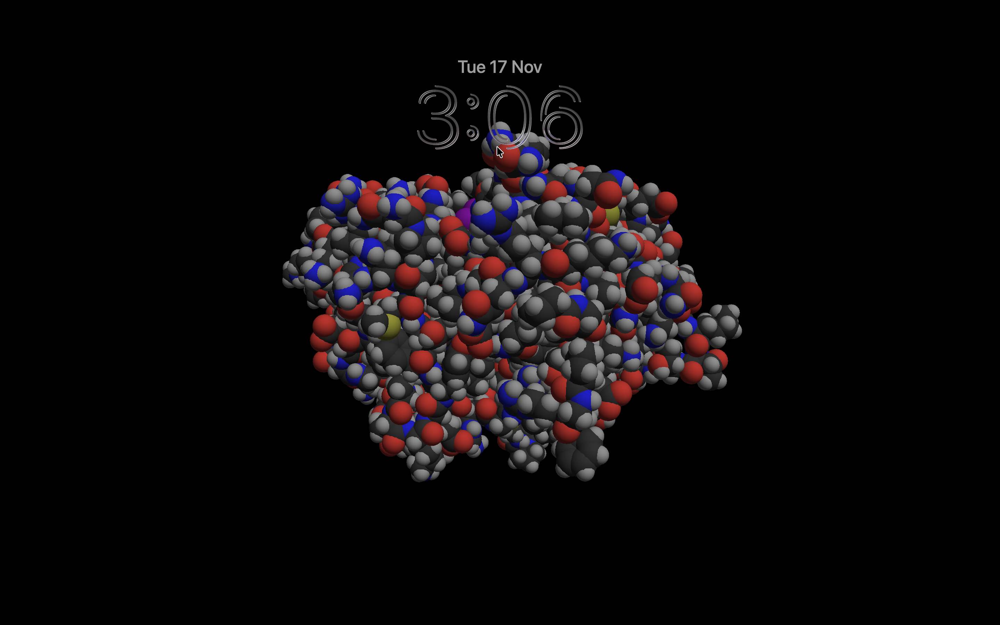

# FAH Saver



A protein-model screensaver for macOS and Windows. Display the active
Folding@home work unit from this computer or another computer over a private
LAN or Tailscale network.

This is an independent project, not an official Folding@home product.

## Install

The download links and Homebrew command below require a published stable release.
Draft release assets are available to repository maintainers for review.

### macOS (Apple silicon)

Install with Homebrew:

```sh
brew install --cask le0-VV/fah-saver/fah-saver
```

If an older copy was installed manually in `/Library/Screen Savers` or
`~/Library/Screen Savers`, remove that copy before switching to Homebrew. Keep
your existing preferences.

For manual installation, download the
[Apple-silicon ZIP](https://github.com/le0-VV/FAH-saver/releases/latest/download/FAHSaver-macos-arm64.zip),
extract it and open `FAHSaver.saver`.

Select **FAH Saver** in macOS Screen Saver settings and open **Options** to
configure the FAH source.

### Windows x64

Download and run
[FAH Saver Setup.exe](https://github.com/le0-VV/FAH-saver/releases/latest/download/FAHSaver-Setup.exe).
Setup handles the permanent location and screensaver registration. You can
delete the downloaded installer afterwards. To update, run the newer installer;
existing preferences and cached models are preserved.

### Connect to Folding@home

When FAH runs on the same computer, set the source to
`ws://127.0.0.1:7396/api/websocket`. For another folding computer, use its private
LAN or Tailscale address and follow the [direct-access instructions](docs/direct-access.md).

## TODO

- [ ] Folding@home account connection.
- [ ] Upscaling integration.
- [ ] Further renderer optimisation.
- [ ] Linux release.

## Licence

FAH Saver's original code is licensed under **GPL-3.0-or-later**. See
[LICENSE](LICENSE), [COPYRIGHT](COPYRIGHT) and the
[third-party notices](THIRD-PARTY-NOTICES.md). Third-party components retain
their own licences. Corresponding source is included with each release.

For build instructions, technical details, performance measurements and known
limitations, see the [documentation in `docs/`](docs/).
